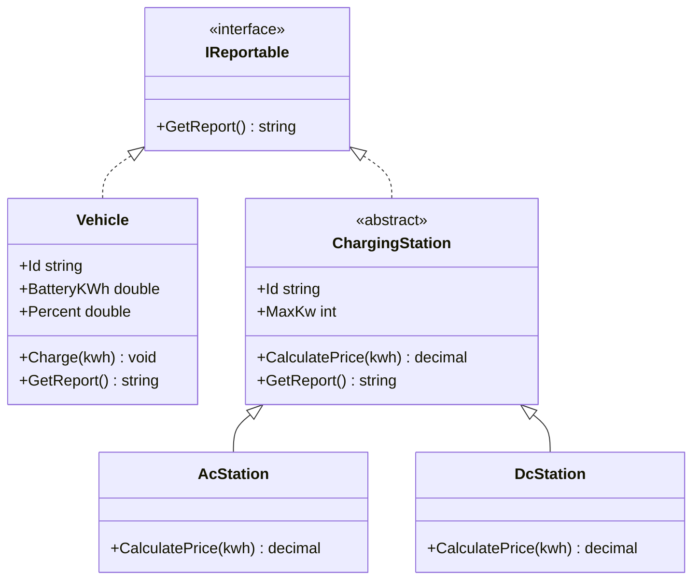

# ChargeHub.Pricing

## Programmering 2 – Lektion 3, Hemläxa

Detta projekt är en del av ChargeHub och är skrivet i C# med .NET 10.

Programmet hanterar elbilar och laddstationer samt skriver ut en enkel rapport om objekten.

## Funktioner

- Vehicle representerar en elbil med batterikapacitet och laddningsprocent.
- ChargingStation är en abstrakt basklass för laddstationer.
- AcStation representerar en AC-laddstation på 11 kW.
- DcStation representerar en DC-laddstation på 150 kW.
- IReportable är ett interface som används för att skapa rapporter.
- Programmet använder List<IReportable> och foreach för att skriva ut rapporterna.

## Klassdiagram



## Exempel på utskrift

```text
Bil 1: 0 %
Station AC-01: 11 kW
Station DC-01: 150 kW
```

## Kör programmet

Öppna terminalen i projektmappen och kör:

```bash
dotnet run
```

## Teknik

- C#
- .NET 10
- Visual Studio Code
- Git och GitHub

## Sammanfattning

I denna uppgift har jag lärt mig att använda interface, abstrakta klasser, arv och polymorfism.

Genom IReportable kan både bilar och laddstationer använda samma metod GetReport(), trots att de är olika typer av objekt.
